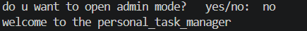
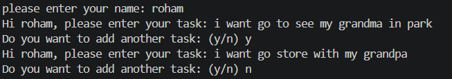
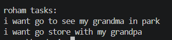
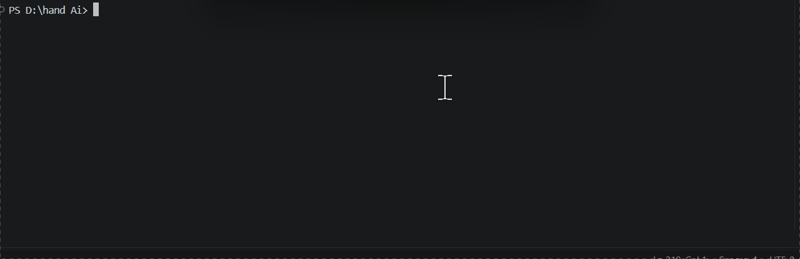

# Personal Task Manager


A simple personal task manager built with Python.

## Description

This project is a beginner-friendly task manager that allows users to enter their name and add personal tasks. The program displays the tasks entered by the current user and saves them in a `tasks.txt` file for future reference. It also includes an optional admin mode protected by a password stored in an environment variable.

## Table of Contents

* [Features](#features)
* [Project Structure](#project-structure)
* [File Description](#file-description)
* [Requirements](#requirements)
* [Installation](#installation)
* [Environment Setup](#environment-setup)
* [Usage](#usage)
* [Example Output](#example-output)
* [Screenshot](#screenshot)
* [Demo](#demo)
* [Roadmap](#roadmap)
* [Contributing](#contributing)
* [License](#license)
* [Author](#author)

## Features

* Ask the user for their name.
* Allow users to add multiple tasks.
* Display the tasks entered by the current user.
* Save tasks in a text file.
* Keep tasks from different users organized by name.
* Provide an optional password-protected admin mode.
* Use environment variables to store the admin password.

## Project Structure

```text
personal-task-manager/
│
├── main.py
├── tasks.txt
├── requirements.txt
├── .env.example
├── .gitignore
├── README.md
│
├── pictures/
│   ├── 1.png
│   ├── 2.png
│   └── 3.png
│
└── GIFs/
    └── demo.gif
```

## File Description

| File               | Description                                            |
| ------------------ | ------------------------------------------------------ |
| `main.py`          | Contains the main program and task management logic.   |
| `tasks.txt`        | Stores tasks entered by different users.               |
| `requirements.txt` | Lists the Python packages required by the project.     |
| `.env.example`     | Shows the environment variables needed by the project. |
| `.gitignore`       | Specifies files and folders that Git should ignore.    |
| `README.md`        | Contains the project documentation.                    |
| `pictures/`        | Stores project screenshots.                            |
| `pictures/1.png`   | Shows the program welcome screen.                      |
| `pictures/2.png`   | Shows the task entry section.                          |
| `pictures/3.png`   | Shows the user's task list.                            |
| `GIFs/`            | Stores demo GIF files.                                 |
| `GIFs/demo.gif`    | Shows a demonstration of the project.                  |

## Requirements

* Python 3
* `python-dotenv`

## Installation

1. Clone the repository:

```bash
git clone YOUR_REPOSITORY_URL
```

2. Navigate to the project directory:

```bash
cd personal-task-manager
```

3. Install the required packages:

```bash
pip install -r requirements.txt
```

## Environment Setup

1. Create a `.env` file from `.env.example`:

```bash
cp .env.example .env
```

2. Open the `.env` file.

3. Set your admin password:

```text
task_manager_ADMIN_PASSWORD=your_password_here
```

4. Save the file.

> Do not commit your `.env` file because it contains your private admin password.

## Usage

1. Start the program:

```bash
python main.py
```

2. Choose whether to open admin mode by entering `yes` or `no`.

3. If you choose `yes`, enter the admin password.

4. Enter your name.

5. Type your tasks when prompted.

6. Enter `y` to add another task or `n` to finish.

7. View your tasks in the terminal. Your tasks will also be saved in `tasks.txt`.

## Example Output

```text
do u want to open admin mode?   yes/no:  no
welcome to the personal_task_manager
please enter your name: roham
Hi roham, please enter your task: Study Python
Do you want to add another task: (y/n) y
Hi roham, please enter your task: Solve programming problems
Do you want to add another task: (y/n) n

roham tasks:
Study Python
Solve programming problems
```

Example `tasks.txt` content:

```text
roham tasks:
Study Python
Solve programming problems

```

## Screenshot








## Demo

Watch the project demonstration:



## Roadmap

* [ ] Allow users to view previously saved tasks.
* [ ] Add an option to delete tasks.
* [ ] Add an option to edit existing tasks.
* [ ] Improve admin mode with additional features.
* [ ] Add task completion status.
* [ ] Improve input validation and error handling.

## Contributing

Contributions are welcome!

1. Fork the repository.
2. Create a new branch.
3. Make your changes.
4. Commit your changes.
5. Open a pull request.

## License

This project is licensed under the MIT License.

## Author

**Roham Mirzaei**

* GitHub: [Your GitHub Profile](https://github.com/roham-m?tab=repositories)
